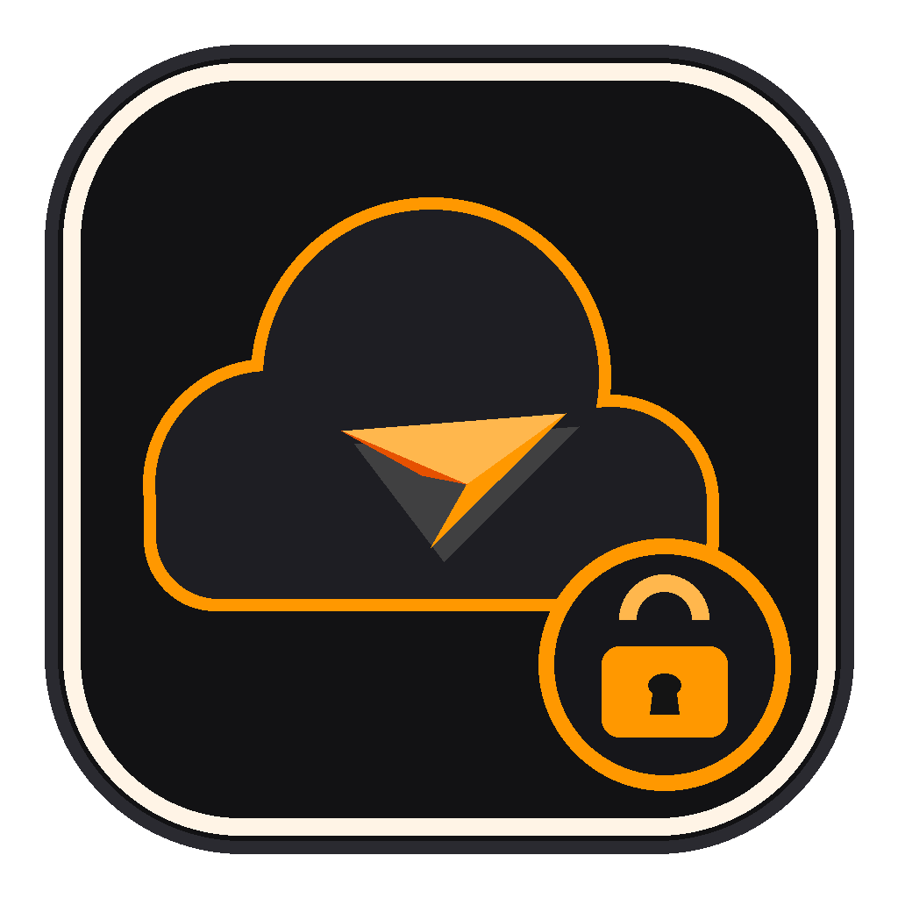

# TGCloud — Telegram Cloud Storage (Android)

<p align="center">
  
</p>

<p align="center">
  <strong>Penyimpanan Cloud Pribadi Terenkripsi Berbasis Telegram Bot API di Android</strong>
</p>

<p align="center">
  
  
  
  
  
</p>

---

## 📌 Gambaran Umum

**TGCloud** adalah aplikasi Android berbasis Flutter yang memanfaatkan infrastruktur Telegram (Bot API & channel privat) sebagai backend penyimpanan cloud tanpa batas kuota berbayar. Dirancang untuk arsip video, foto, dan dokumen penting dengan standar keamanan **Zero-Knowledge Encryption** di sisi klien (client-side).

File dipotong (*chunking*) otomatis sebesar 15 MB, dienkripsi menggunakan **AES-256-GCM** dengan kunci derivasi PIN pengguna, dan diunggah ke channel privat Telegram. Hanya pemilik kunci PIN yang dapat mendekripsi dan merekonstruksi file kembali.

---

## ✨ Fitur Utama

- 🔐 **Enkripsi Client-Side AES-256-GCM**: Kunci enkripsi 256-bit diturunkan langsung dari PIN pengguna via PBKDF2-HMAC-SHA256 (10.000 iterasi). Telegram hanya menyimpan bongkahan data biner acak (*ciphertext*).
- 🧩 **Streaming Chunking 15 MB**: Mengatasi batasan Bot API Telegram (50MB upload / 20MB download). Mampu menangani file berukuran ratusan megabyte hingga gigabyte dengan konsumsi RAM rendah (<60MB).
- ⚡ **Worker Pool Concurrency (Maks 2 Paralel)**: Keseimbangan optimal antara throughput kecepatan transfer dan proteksi rate limit Telegram (~30 request/detik) serta kestabilan memori perangkat Android.
- 🔄 **Double SHA-256 Verification**:
  1. Integritas chunk terenkripsi diverifikasi sebelum didekripsi.
  2. Integritas file hasil reassembly akhir dicocokkan dengan hash asli sebelum disajikan ke pengguna.
- 🛑 **Pembersihan Bersih (Clean Cancellation)**: Membatalkan upload di tengah jalan secara otomatis memicu penghapusan remote chunk di channel via Telegram `deleteMessage` dan membersihkan entri SQLite lokal.
- 🗄️ **Metadata Lokal SQLite (`tgcloud.db`)**: Seluruh katalog file, urutan chunk, dan riwayat transfer tersimpan lokal dan persisten di perangkat.
- 🛡️ **Android Foreground Service**: Proses transfer file besar dipertahankan melalui notifikasi sticky berprogres agar tidak dihentikan oleh Android Doze Mode / battery saver.
- 📂 **Cadangan Media (Manual & Otomatis)**: Scan folder kamera/media dengan deduplikasi otomatis berbasis SHA-256 sehingga hanya file baru yang terunggah.
- 🎨 **Desain Dark Charcoal & Amber**: UI maskulin bernuansa charcoal gelap (`#121212`) dan aksen amber hangat (`#FF9800`) berbahasa Indonesia.

---

## 🏗️ Arsitektur & Alur Kerja

```
[File Asli di HP]
       │
       ▼
 [Hitung SHA-256 Asli] ─── (Cek Deduplikasi di SQLite)
       │
       ▼
[Streaming Chunking (15 MB)] ─── (RandomAccessFile)
       │
       ▼
[Enkripsi AES-256-GCM] ─── (Isolate compute + Salt + Nonce)
       │
       ▼
[Worker Pool (Maks 2)] ─── (Dio Multipart sendDocument)
       │
       ▼
 [Channel Telegram Privat] ─── (Simpan file_id & message_id ke SQLite)
```

### Rekonstruksi Unduhan (Download Flow)
1. Aplikasi membaca metadata dan urutan chunk dari SQLite lokal.
2. Mengambil tautan download dari Telegram via `getFile`.
3. Mengunduh chunk dan memverifikasi hash `sha256_chunk`.
4. Mendekripsi byte biner dengan PIN pengguna via AES-256-GCM.
5. Menulis hasil dekripsi langsung ke disk (*streaming append*).
6. Memverifikasi hash `sha256_original` total. File siap dibuka melalui intent Android (`open_filex`).

---

## 🔒 Model Keamanan & Kredensial

Aplikasi menerapkan praktik keamanan bebas hardcode:
- Kredensial Bot Telegram dimasukkan saat build via `--dart-define`.
- Tidak ada token rahasia yang tersimpan di repositori git.

| Parameter `--dart-define` | Deskripsi |
|---|---|
| `TG_BOT_TOKEN` | Token API bot Telegram yang diperoleh dari [@BotFather](https://t.me/BotFather) |
| `TG_CHAT_ID` | ID numerik channel privat tempat bot menjadi Administrator (contoh: `-100123456789`) |

---

## 🚀 Panduan Setup & Instalasi

### 1. Buat Bot Telegram & Channel Privat
1. Buka Telegram dan hubungi [@BotFather](https://t.me/BotFather), ketik `/newbot`, ikuti petunjuk untuk mendapatkan **Bot Token**.
2. Buat Channel Privat baru di Telegram.
3. Buka pengaturan Channel ➔ **Administrators** ➔ **Add Admin** ➔ Cari bot Anda dan beri hak posting pesan.
4. Dapatkan Chat ID Channel (bisa melalui bot seperti `@userinfobot` atau forward pesan channel ke `@JsonDumpBot`).

### 2. Clone Repositori
```bash
git clone https://github.com/Mengggzz/Telegram-Cloud.git
cd Telegram-Cloud
```

### 3. Pasang Dependensi
```bash
flutter pub get
```

### 4. Jalankan Pengujian Otomatis
```bash
flutter test
flutter analyze
```

---

## 📦 Membangun Aplikasi (Build APK)

### Debug Run
```bash
flutter run \
  --dart-define=TG_BOT_TOKEN="YOUR_BOT_TOKEN" \
  --dart-define=TG_CHAT_ID="YOUR_CHAT_ID"
```

### Release APK
```bash
flutter build apk --release \
  --dart-define=TG_BOT_TOKEN="YOUR_BOT_TOKEN" \
  --dart-define=TG_CHAT_ID="YOUR_CHAT_ID"
```

### Split per ABI (Ukuran APK Ringan)
```bash
flutter build apk --release --split-per-abi \
  --dart-define=TG_BOT_TOKEN="YOUR_BOT_TOKEN" \
  --dart-define=TG_CHAT_ID="YOUR_CHAT_ID"
```

Hasil build APK berada di direktori:
`build/app/outputs/flutter-apk/app-release.apk` (atau `app-arm64-v8a-release.apk`).

---

## 🛠️ Tech Stack & Dependensi

- **Framework**: Flutter 3.47+ / Dart 3.13+
- **HTTP & Networking**: `dio` (^5.7.0)
- **Local Database**: `sqflite` (^2.4.1), `sqflite_common_ffi`
- **Cryptography**: `encrypt` (^5.0.3), `crypto` (^3.0.6)
- **Background Tasks**: `flutter_foreground_task` (^11.0.3), `workmanager` (^0.5.2)
- **File & Media Handling**: `file_picker` (^8.1.7), `path_provider`, `open_filex` (^4.5.0)

---

## 📄 Lisensi

Didistribusikan di bawah lisensi **MIT License**. Lihat file `LICENSE` untuk rincian lengkap.
